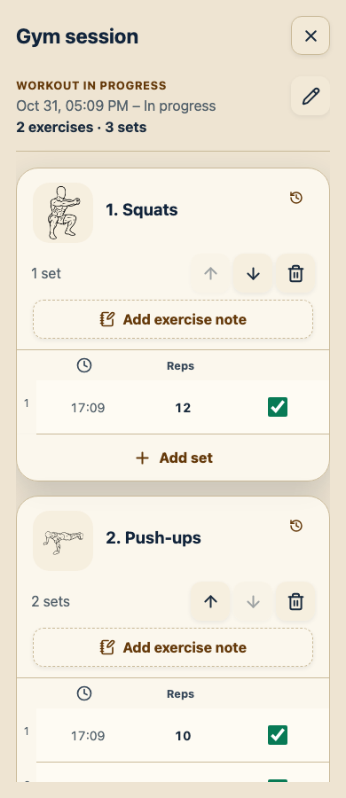
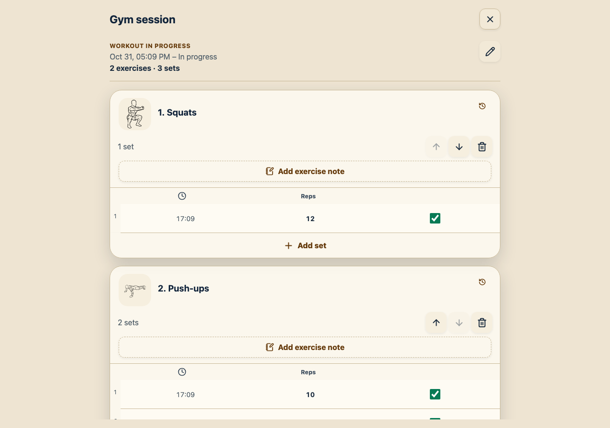
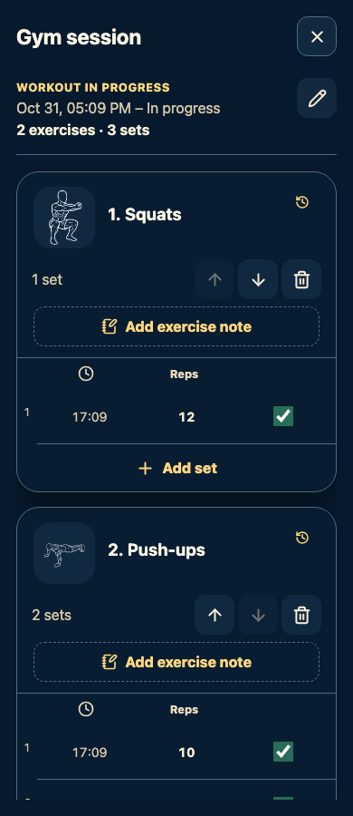
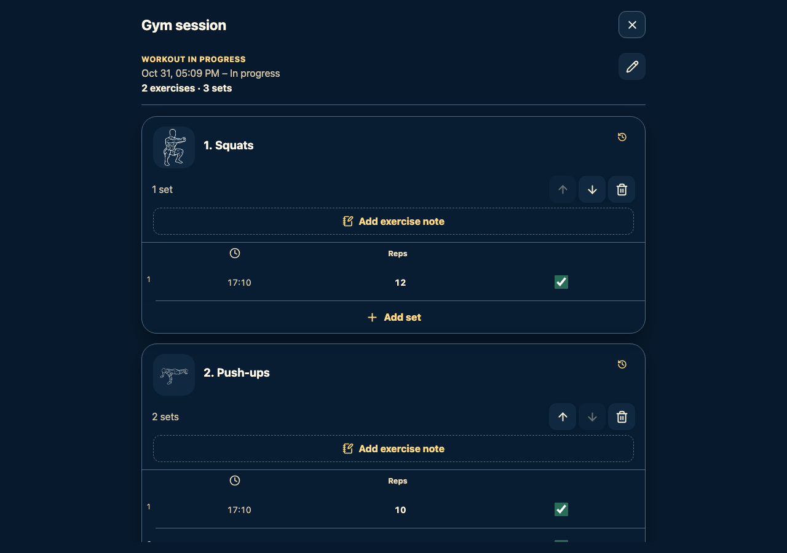

# Rostam 2.0.0 workout verification

Verified on 31 October 2026 using isolated temporary SQLite databases. Existing user data was not used.

- Backend: 100 tests passed; Ruff lint and formatting checks passed.
- Frontend: 142 tests passed; TypeScript, ESLint, and production build passed.
- Browser: all 44 Playwright scenarios passed, including six new real-API workout scenarios. The six workout scenarios were rerun after the final layout and same-minute prefill changes.
- Workout scenarios cover multiple exercises/sets, ordering, renaming, explicit unsaved-input protection, reload/resume, finishing, completed-set editing, shared history, green dots, past-date entry, invalid time rejection, confirmed exercise/workout removal, and connection loss without replaying writes.
- Backend tests additionally cover migration/backup restore, midnight date boundaries, DST, single-active concurrency, membership validation, archived exercises, pagination, rotation separation, mixed calendar sources, and removal of the final qualifying record.

Screenshots use Chromium at 390×900 and 1280×900 in system light and dark themes. These are browser simulations, not physical-device checks.

| Phone | Desktop |
| --- | --- |
|  |  |
|  |  |

The build reports the existing ineffective-dynamic-import warning for the shared Modal component. The essential precache remains approximately 426 KB uncompressed across ten files.
